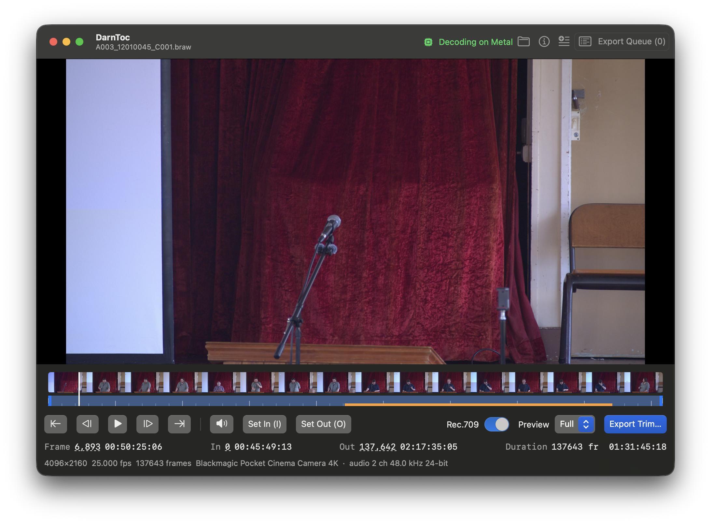

  

# DarnToc for Blackmagic RAW

**Trim Blackmagic RAW clips on your Mac, losslessly.**

DarnToc opens a `.braw` clip, lets you find exactly the frames you want, and saves them as a new `.braw` file. Frames are copied exactly as the camera recorded them: no re-encoding, no quality loss. The new file opens in DaVinci Resolve like any other Blackmagic RAW clip, with all of its camera metadata intact.

It's built for the everyday job of cutting a long recording down to the parts you actually need before you edit, archive or share it.

**[⬇ Download the latest version](../../releases/latest)**

---

## Features

- **Lossless trims.** Frames are copied byte-for-byte, so quality is identical to the original.
- **Fast preview.** Smooth scrubbing and playback with sound, decoded on your Mac's GPU. A filmstrip and timeline help you find your place in long clips.
- **Frame-accurate In and Out.** Press I and O, drag the handles, or type an exact frame number, timecode or offset (+5, −10).
- **Rec.709 preview.** Shows log (Film) footage with normal contrast while you choose frames. Exported files keep the camera's original settings.
- **Export queue.** Mark several ranges, from one clip or many, then export them all to a folder in one go.
- **Honest progress.** Shows how much has been written and roughly how long is left, which helps with very large clips.
- **Safe exports.** Every file is written under a temporary name, then reopened and frame-counted before it's given its final name. A failed, cancelled or interrupted export never leaves a damaged file that looks like a finished clip. The Mac won't sleep during an export, and existing files are never overwritten by the queue.
- **Metadata kept.** Camera, lens, scene and take, timecode, GPS location, per-frame data, audio and embedded LUTs all carry over. Settings saved in a `.sidecar` file (e.g. from Resolve) are written into the trimmed file.
- **Clip Info.** Press ⌘I to see camera and per-frame details for the clip and frame you're looking at.
- **Built-in help.** Help → DarnToc Help (⌘?).

## Requirements

- macOS 14 Sonoma or later
- Apple silicon or Intel Mac (runs natively on both; no Rosetta)
- Blackmagic RAW (`.braw`) clips. Tested with Blackmagic Pocket Cinema Camera 4K footage.

## Install

1. Download `DarnToc-<version>.dmg` from the [Releases page](../../releases/latest).
2. Open it and drag **DarnToc** to **Applications**.
3. Open DarnToc. On first launch macOS asks you to confirm opening an app downloaded from the internet; click **Open**.

DarnToc is signed with a Developer ID and notarised by Apple.

To open clips straight from Finder, right-click a `.braw` file and choose **Open With → DarnToc**.

## Quick start

1. Press ⌘O or drag a clip onto the window.
2. Scrub to the first frame you want and press **I**; scrub to the last and press **O**.
3. Press ⌘E to export, or **A** to add the range to the queue and export several at once.

Space plays, ←/→ step one frame, ⇧←/⇧→ step ten, and ⌘G jumps to a frame or timecode. The full shortcut list is in the built-in help.

## Privacy

DarnToc works entirely on your Mac. It collects no data, has no analytics and makes no network connections of its own. The only exception: clicking a GPS location in Clip Info opens Apple Maps. The export queue is stored locally in `~/Library/Application Support/DarnToc`.

## Disclaimer

DarnToc is provided **as is, without warranty of any kind**. It only ever reads your original clips and writes new files, but always keep backups of important footage.

## Acknowledgements

DarnToc uses the Blackmagic RAW SDK. The Blackmagic RAW SDK and its API libraries are © Blackmagic Design Pty. Ltd. Blackmagic Design, Blackmagic and Blackmagic RAW are trademarks of Blackmagic Design Pty. Ltd.

**DarnToc is an independent product. It is not made, endorsed or supported by Blackmagic Design.**

The Blackmagic RAW SDK licence and third-party notices are included in the app: **Help → Acknowledgements**.

## Feedback

Found a problem or have a suggestion? Open an [issue](../../issues).

© 2026 Andrew Rees
